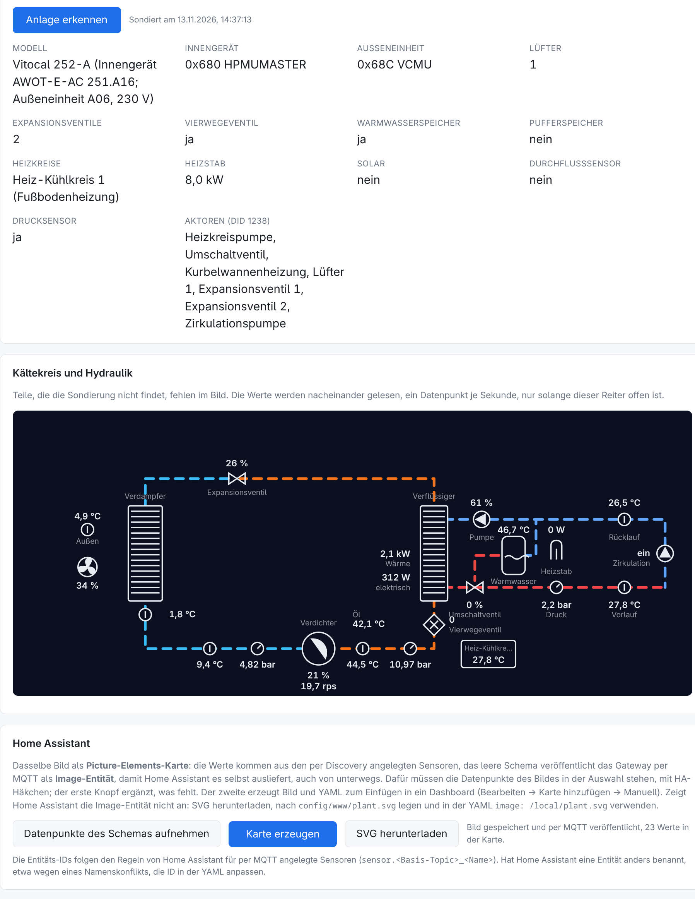

# open3e Gateway für das Waveshare ESP32-S3-RS485-CAN

Firmware, die Viessmann-E3-Geräte (Vitocal, Vitodens, VX3/Vitocharge) direkt am
CAN-Bus ausliest und nach MQTT bringt — ohne Raspberry Pi, ohne Python, ohne
SocketCAN. Das Board hat einen galvanisch getrennten CAN-Transceiver, WLAN und
läuft an 7–36 V direkt im Heizungsraum.

**Dokumentation:** <https://esp32can.thomas-peterson.de/doku/>
· **Flashen aus dem Browser:** <https://esp32can.thomas-peterson.de>
· **Änderungen:** [CHANGELOG.md](CHANGELOG.md)

Ablauf aus Anwendersicht:

1. Erster Start → das Gerät spannt einen WLAN-Hotspot auf, das Captive Portal
   öffnet die Einrichtungsseite von selbst.
2. WLAN auswählen, Passwort eingeben → Neustart, danach erreichbar unter
   `http://open3e.local`.
3. Im Web-UI einen Bus-Scan starten → gefundene ECUs und Datenpunkte erscheinen.
4. Pro Datenpunkt festlegen, ob und auf welches MQTT-Topic er gesendet wird.

Die Topics, Payloads, der LWT und das Kommando-Topic orientieren sich an
[open3e](https://github.com/open3e/open3e). Einschränkungen des Kommando-Listeners
sind unter [MQTT](docs/mqtt.md#kommandos) beschrieben.

## Dokumentation

Die Kapitel liegen als Markdown unter [`docs/`](docs/) und erscheinen, mit
Navigation und Suche, unter <https://esp32can.thomas-peterson.de/doku/>.

**Einstieg**

- [Hardware](docs/hardware.md): Pins, Verkabelung, Abschluss, Bus-Diagnose
- [Aufbau in der Praxis](docs/aufbau-praxis.md): Fotos und Stecker an einer Vitodens
- [Aus dem Browser flashen](docs/flashen.md)
- [Erste Einrichtung](docs/einrichtung.md) und [Bus-Scan](docs/bus-scan.md)

**Betrieb**

- [Anlage](docs/anlage.md): Kältekreis, Kessel, Stromspeicher und Photovoltaik als Bild
- [MQTT](docs/mqtt.md): Topics, Kommandos, Home Assistant
- [Schreiben auf den Bus](docs/schreiben.md)
- [Sichern und wiederherstellen](docs/sichern.md),
  [Firmware-Update](docs/update.md), [Zurücksetzen](docs/zuruecksetzen.md)

**Anbindungen**

- [WireGuard](docs/wireguard.md)
- [Aus dem Netz laden (Vitocharge VX3)](docs/netzladen.md)
- [Energiezähler E380](docs/e380.md)
- [Kontakteingänge und Schaltausgänge](docs/kontakte.md)
- [KNX](docs/knx.md) und [evcc](docs/evcc.md)
- [Rohdaten für externe Integrationen](docs/rohdaten.md),
  [Raw-Gateway-API](docs/raw-gateway-api.md)

**Entwicklung**

- [Bauen und flashen](docs/bauen.md)
- [Wie das intern zusammenhängt](docs/intern.md) und [Tests](docs/tests.md)
- [Was (noch) nicht drin ist](docs/grenzen.md)

Die Seite selbst baut `make docs` (einmalig vorher `make docs-setup`) nach
`build/site/doku/`; im Normalfall erledigt das GitHub Actions zusammen mit der
Flash-Seite, siehe [`site/README.md`](site/README.md).

## Lizenz

**Apache License 2.0** — siehe [`LICENSE`](LICENSE).
