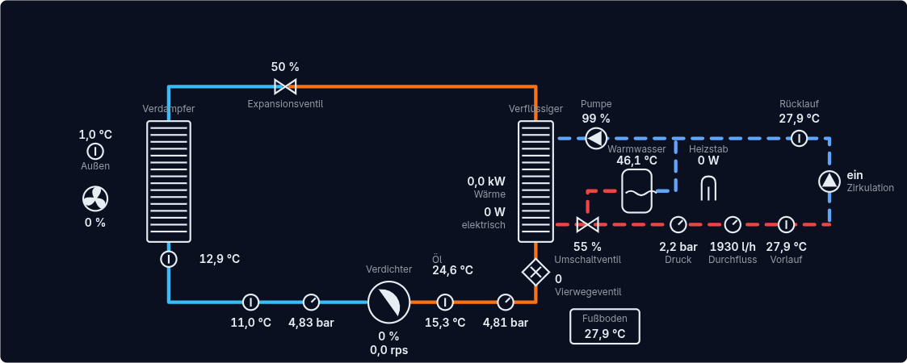
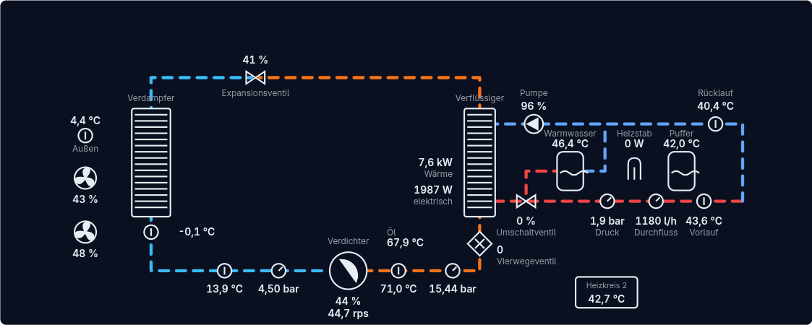
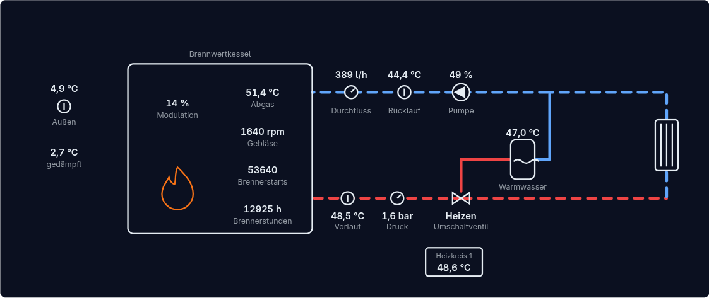
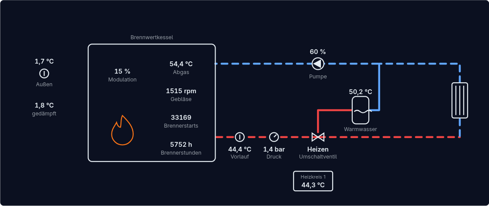
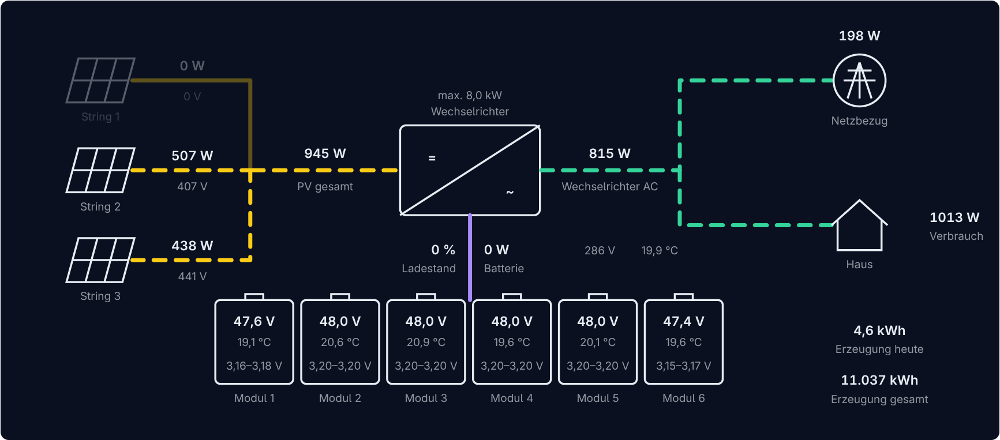

# Bekannte Anlagen

Der Reiter [Anlage](anlage.md) erkennt aus dem Bus-Scan, was angeschlossen
ist, und zeichnet daraus ein Schema. Diese Seite sammelt die Anlagen, an denen
das bisher gelaufen ist, mit je einem Beispielbild. Fehlt deine, steht unten,
[wie du sie meldest](#meine-anlage-fehlt).

Datenpunkte lesen, per MQTT veröffentlichen und schreiben geht an jedem Gerät
am E3-Bus, das der Scan findet – dafür muss ein Modell nicht in dieser Liste
stehen. Die Liste betrifft nur die Erkennung und das Bild.

## Übersicht

| Anlage | Art | Bild | Stand |
| --- | --- | --- | --- |
| Vitocal 252-A (Innengerät AWOT-E-AC 251.A16, Außeneinheit A06, 230 V) | Wärmepumpe, Split | Kältekreis und Hydraulik | läuft dauerhaft, Anlage des Autors |
| Vitocal 150-A (Innengerät AWMIW.A1.19, Außeneinheit AWMOF-151.A1.13, 400 V) | Wärmepumpe | Kältekreis und Hydraulik | aus eingereichten Daten, vom Besitzer in Betrieb |
| Vitodens 300-W (B3HG) | Gas-Brennwert | Kessel und Hydraulik | aus eingereichten Daten |
| Vitodens 333-F | Gas-Brennwert mit Speicher | Kessel und Hydraulik | am Gerät bestätigt, Umschaltventil in beiden Stellungen |
| Vitodens 343-F mit Solarthermie | Gas-Brennwert mit Solarspeicher | Kessel, Hydraulik und Solarkreis | am Gerät bestätigt, kein Beispielbild |
| Vitodens 200-W | Gas-Brennwert | Kessel und Hydraulik | aus eingereichten Daten, vom Besitzer in Betrieb |
| Vitocharge VX3 | Stromspeicher mit Wechselrichter | Photovoltaik und Batterie | läuft dauerhaft, Anlage des Autors |
| Vitovent | Lüftung | keines | nur Datenpunkte |

## Wärmepumpen

### Vitocal 252-A

Split-Gerät mit integriertem Warmwasserspeicher, einem direkten
Heiz-/Kühlkreis, Heizstab und Zirkulationspumpe. Das Bild stammt vom laufenden
Gateway.

### Vitocal 150-A

Mit Trennpuffer, gemischtem zweitem Heizkreis und Heizstab. Das Bild ist aus
den Dateien erzeugt, die der Besitzer in
[Diskussion 22](https://github.com/boonkerz/open3e-esp32/discussions/22)
eingereicht hat; Durchfluss und Ventilstellung sind Beispielwerte, weil sie in
der Sondierung fehlen.

## Gas-Brennwertkessel

Die Bilder sind aus eingereichten Dateien aus
[Diskussion 23](https://github.com/boonkerz/open3e-esp32/discussions/23)
erzeugt. Modulation, Abgastemperatur, Gebläsedrehzahl, Brennerstarts und
-stunden sowie die gedämpfte Außentemperatur sind Beispielwerte: die
Sondierung, die dem Bild zugrunde liegt, enthält sie nicht.

### Vitodens 300-W (B3HG)

### Vitodens 333-F

Der Strang, den das Umschaltventil gerade nicht bedient, steht im Bild still.
Das ist an diesem Gerät in beiden Stellungen geprüft.

### Vitodens 343-F mit Solarthermie

Zusätzlich zum Kessel zeichnet der Reiter den Solarkreis mit Kollektor- und
Speichertemperatur. Ein Besitzer hat das Bild samt Werten als stimmig
bestätigt; ein Beispielbild fehlt, weil keine Dateien dieser Anlage vorliegen.

### Vitodens 200-W

Das Gerät hat weder Durchflussmesser noch Rücklauffühler. Der Datenpunkt
dafür (1043) steht trotzdem im Scan und meldet Nullen mit dem Status 4; der
Reiter lässt beide dann weg. Nach einem Update dafür einmal *Anlage erkennen*
drücken. Das Bild ist aus den Dateien des Besitzers aus
[Diskussion 22](https://github.com/boonkerz/open3e-esp32/discussions/22)
erzeugt, die Brennerwerte stammen aus seinem Bildschirmfoto.

## Stromspeicher und Photovoltaik

### Vitocharge VX3

Drei Strings, Wechselrichter, Netzanschlusspunkt, Hausverbrauch und sechs
Batteriemodule mit Spannung, Temperatur und Zellspannungen. Die Karte erscheint
im Reiter Anlage, sobald der Scan ein Vitocharge findet.

An dieser Anlage ungeprüft: die Anzeige bei Einspeisung und das Vorzeichen der
Batterieleistung.

## Meine Anlage fehlt

Zwei Dateien genügen, um eine Anlage aufzunehmen oder einen Fehler im Bild zu
finden:

1. **system.json**, das Ergebnis des Bus-Scans: im Browser
   `http://<Gateway>/api/system` öffnen und die Seite speichern.
2. **plant.json**, die Sondierung: im Reiter *Anlage* einmal *Anlage erkennen*
   drücken, dann `http://<Gateway>/api/plant` öffnen und speichern.

Beide in eine
[Diskussion](https://github.com/boonkerz/open3e-esp32/discussions) hängen;
nimmt GitHub `.json` nicht an, die Endung in `.txt` ändern. Hilfreich ist
dazu, was im Bild nicht stimmt und was an der Anlage tatsächlich verbaut ist.

!!! warning "Vor dem Hochladen"
    In beiden Dateien stehen die **Seriennummern** der Geräte (`vin` und
    `ident` in der system.json, die Einträge mit `:377` in der plant.json) und
    die Namen der Heizkreise. Wer sie nicht veröffentlichen möchte, ersetzt die
    hinteren Stellen durch Platzhalter; für die Modellerkennung reichen die
    ersten sieben Ziffern.

    Die **Sicherung** aus *Einstellungen → Wartung* gehört nicht in eine
    Diskussion: sie enthält WLAN- und MQTT-Passwörter und die
    WireGuard-Schlüssel.
