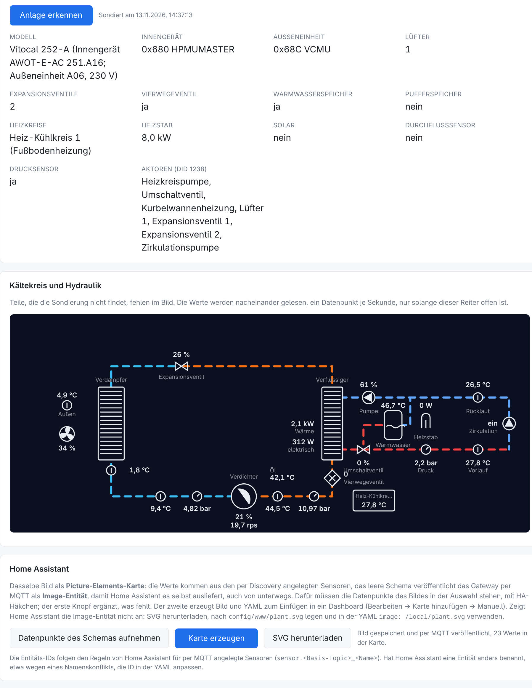
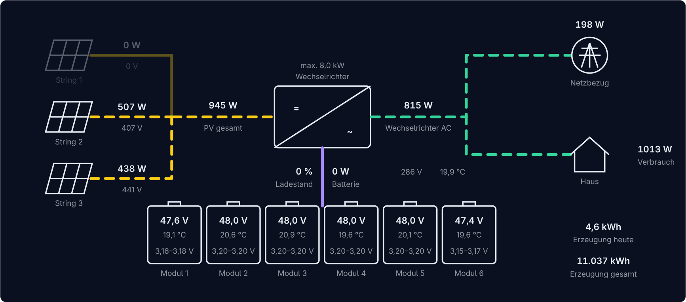

# open3e-Gateway

Firmware für das **Waveshare ESP32-S3-RS485-CAN**, die Viessmann-E3-Geräte
(Vitocal, Vitodens, Vitocharge VX3, Vitovent) direkt am CAN-Bus ausliest und
nach MQTT bringt — ohne Raspberry Pi, ohne Python, ohne SocketCAN. Das Board
hat einen galvanisch getrennten CAN-Transceiver, WLAN und läuft an 7–36 V
direkt im Heizungsraum.

[Aus dem Browser flashen](https://esp32can.thomas-peterson.de/){ .md-button .md-button--primary }
[Quelltext auf GitHub](https://github.com/boonkerz/open3e-esp32){ .md-button }

## In vier Schritten

1. **Flashen.** Board per USB anstecken und auf der
   [Flash-Seite](https://esp32can.thomas-peterson.de/) den Knopf drücken
   ([Einzelheiten](flashen.md)).
2. **Ins WLAN bringen.** Beim ersten Start spannt das Gerät einen Hotspot auf,
   das Captive Portal öffnet die Einrichtungsseite von selbst. Danach ist es
   unter `http://open3e.local` erreichbar ([Erste Einrichtung](einrichtung.md)).
3. **Bus scannen.** Der [Bus-Scan](bus-scan.md) findet die Steuergeräte und
   ihre Datenpunkte.
4. **Datenpunkte auswählen.** Pro Datenpunkt festlegen, ob und auf welches
   [MQTT](mqtt.md)-Topic er gesendet wird.

Wie das Board an den Bus kommt, steht unter [Hardware](hardware.md) und,
mit Fotos aus einer Unterverteilung, unter
[Aufbau in der Praxis](aufbau-praxis.md).

## Was das Gateway kann

**Die Anlage als Bild.** Der Reiter [Anlage](anlage.md) erkennt aus dem Scan,
was verbaut ist, und zeichnet es mit Live-Werten: den Kältekreis einer
Wärmepumpe, den Kessel eines Gas-Brennwertgeräts, Stromspeicher und
Photovoltaik eines Vitocharge. Kältekreis und Kessel gibt es auch als Karte
für Home Assistant. An welchen Modellen das bisher läuft, zeigt
[Bekannte Anlagen](anlagen.md).

**Datenpunkte nach MQTT.** Topics, Payloads, LWT und Kommando-Topic
orientieren sich an [open3e](https://github.com/open3e/open3e); Home Assistant
findet die Werte per Discovery. Näheres unter [MQTT](mqtt.md).

**Schreiben, wenn man es freigibt.** Sollwerte, Betriebsarten und die
Heizkennlinie lassen sich über MQTT, Home Assistant oder die API setzen, mit
Grenzen je Datenpunkt ([Schreiben auf den Bus](schreiben.md)).

**Anbindungen.**

- [WireGuard](wireguard.md) für den Zugriff von unterwegs
- [Laden aus dem Netz](netzladen.md) an einem Vitocharge VX3
- [Energiezähler E380](e380.md), passiv mitgelesen
- [Kontakteingänge und Schaltausgänge](kontakte.md), etwa für SG-Ready
- [KNX](knx.md) und [evcc](evcc.md)
- [Rohdaten](rohdaten.md) für externe Integrationen wie ioBroker.e3oncan

**Update ohne Kabel.** Die Weboberfläche führt durch Sicherung und
Einspielen, Auswahl und Scan bleiben erhalten
([Firmware-Update](update.md)).

## Stand und Hilfe

Was sich zwischen den Versionen geändert hat, steht unter
[Änderungen](changelog.md). Fragen, Fotos vom eigenen Aufbau und Daten
unbekannter Geräte sind in den
[Diskussionen auf GitHub](https://github.com/boonkerz/open3e-esp32/discussions)
willkommen, Fehler als
[Issue](https://github.com/boonkerz/open3e-esp32/issues).

Lizenz: [Apache License 2.0](https://github.com/boonkerz/open3e-esp32/blob/main/LICENSE).
